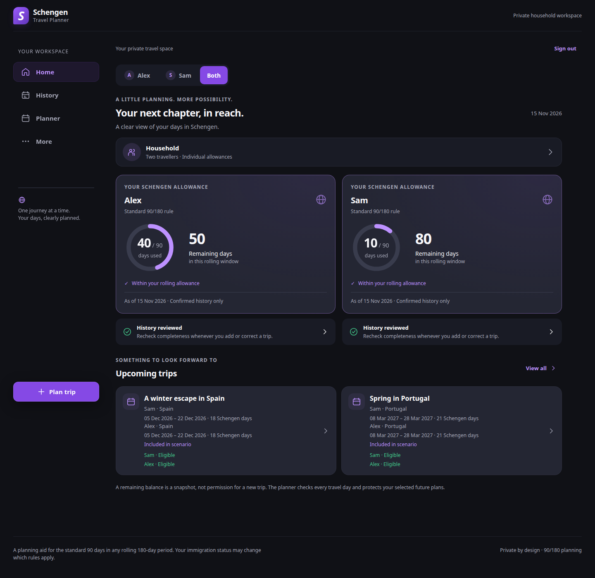
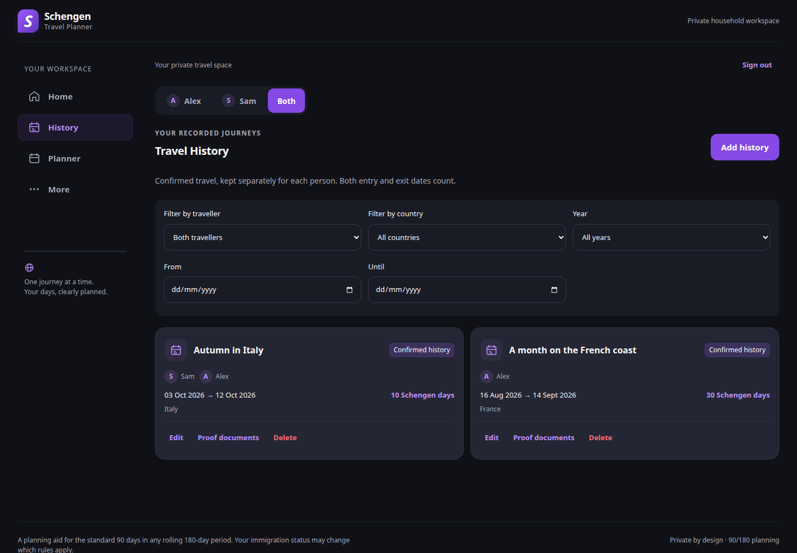
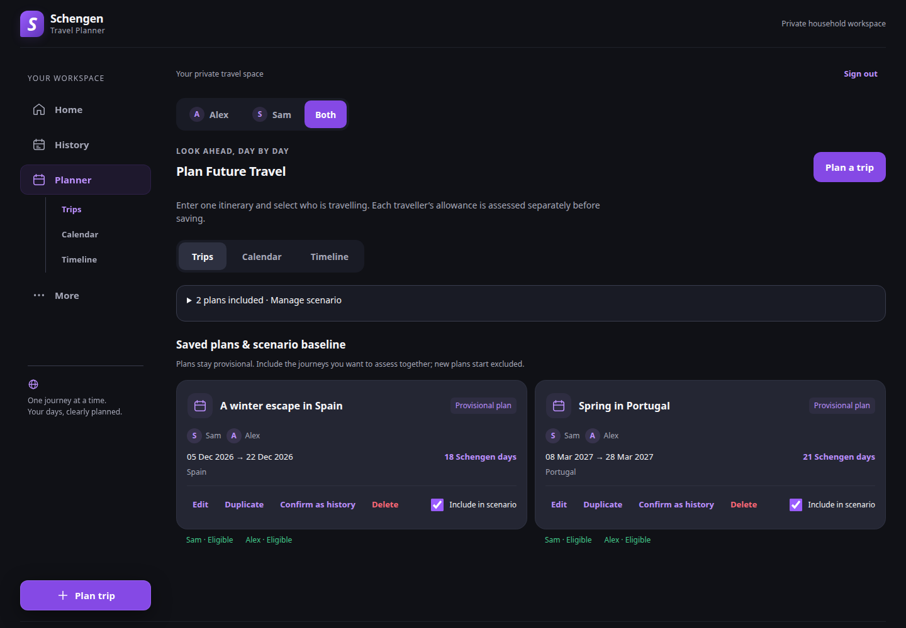
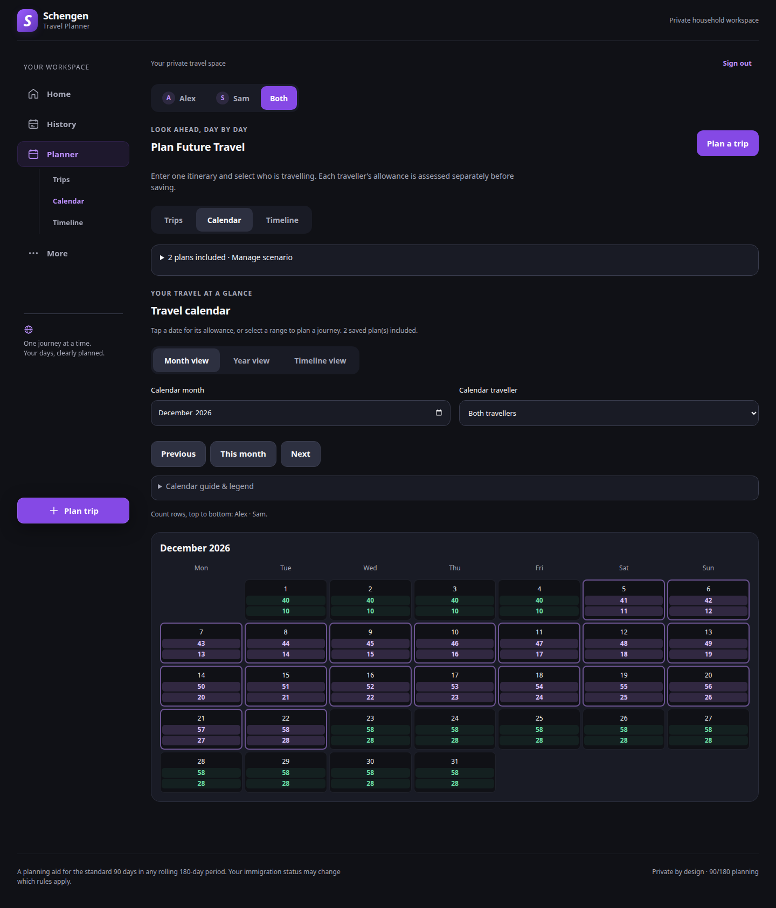
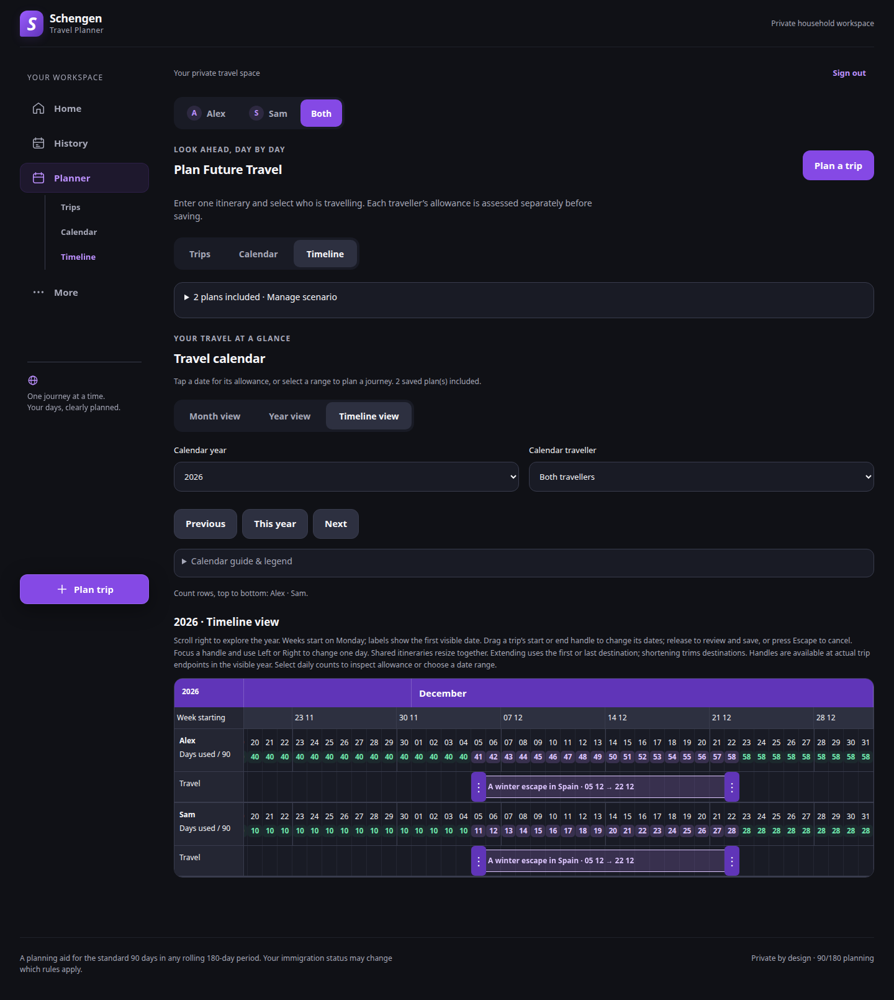
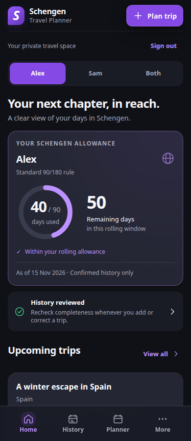
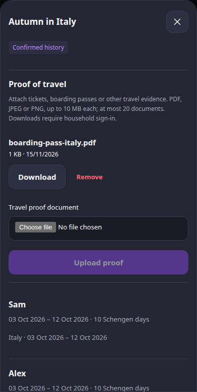
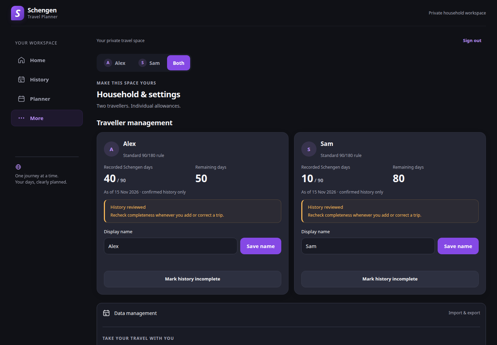
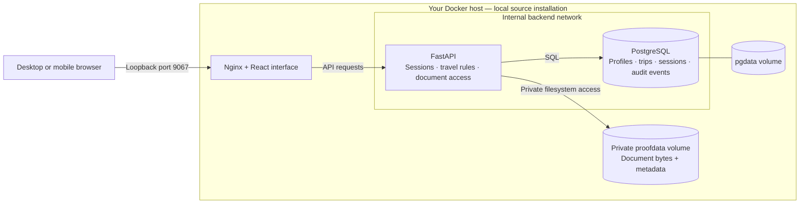
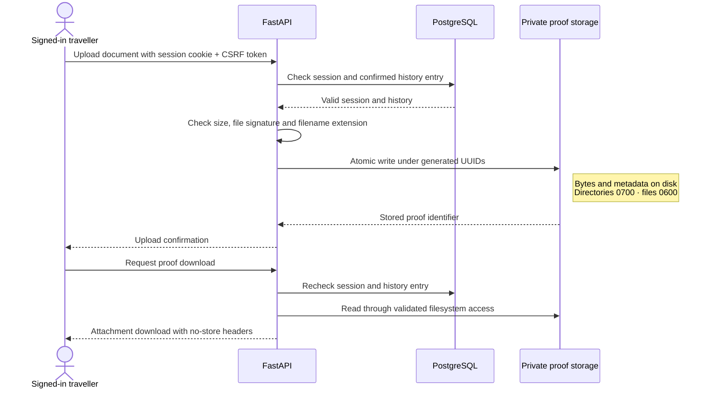

# Schengen Travel Planner

### More time imagining the trip. A clearer view of the days you can use.

Plan European getaways together with a private, self-hosted workspace for two
travellers. See each person's rolling Schengen allowance, explore future journeys,
and keep confirmed travel and its supporting documents in one place.

**One shared itinerary. Two independent allowances. Your own installation.**

[See the app](#see-the-app) · [Architecture](#how-the-solution-fits-together) ·
[Install](#install) · [Password management](#password-management)



## Turn travel ideas into a plan you can review

A long weekend, a winter escape, a month on the coast: every journey changes the
rolling picture. Schengen Travel Planner brings your recorded travel and selected
future plans together so you can understand the impact before you book.

| What you want to do | How the app helps |
| --- | --- |
| Know where you stand today | Separate allowance rings and history-review status for both travellers. |
| Plan a journey together | Enter dates and destinations once, then select either traveller or both. |
| Explore the next trip | See each person's assessment, remaining allowance and any first breach date. |
| Look across the year | Switch between saved trips, month/year calendars and an editable timeline. |
| Keep the evidence close | Attach private travel documents to confirmed history and download them after signing in. |
| Bring your records with you | Preview history CSV imports, export history as CSV, and export history or plans as iCalendar. |
| Keep control of your data | Run the app on your own host with PostgreSQL and a separate private document volume. |

## See the app

These are captures of the working app with **fictional demo travellers and trips**,
using 15 November 2026 as the demo date. No household data or login credentials
appear in the screenshots.

### A clear starting point for every journey

Home brings together today's independently calculated allowances, a reminder to
review history completeness, and upcoming journeys. Select Alex, Sam or both to
focus the workspace. The date updates automatically in everyday use.

### A travel history you can actually maintain

Record countries and inclusive entry/exit dates, filter past journeys, and correct
an itinerary when plans and reality differ. Shared travel appears together, while
each traveller keeps their own day count. Version checks and audit events protect
trip edits from silently overwriting another window's changes.



### Explore the next escape

Save a provisional plan, choose which journeys belong in your current scenario,
and assess their combined impact. The planner checks actual travel dates and
later selected bookings. When a journey becomes real, review the dates and
explicitly confirm it as history.



### See how the days fit together

The month and year calendars show per-person rolling usage alongside recorded
history and selected plans. Inspect a date for details, or choose a start and end
date to begin a new itinerary.



The timeline puts journeys across the year. Drag or use keyboard controls to
preview a date change, then review the adjusted itinerary before saving it.



### Take your workspace with you

The responsive interface works on desktop and mobile, with bottom navigation on
small screens. Keep boarding passes, tickets and other evidence with a history
entry, then download them through your signed-in session.

<p>
  
  
</p>

Proof documents support PDF, JPEG and PNG, up to 10 MiB each and 20 per history
entry. Files and their metadata stay in private file storage. Removing a proof or
deleting its history entry removes the document.

<details>
<summary><strong>Profiles, history review, imports and exports</strong></summary>

**More** brings together profile names, history-completeness review and the
import/export tools. Preview incoming CSV records before committing them; preview
exports before downloading a history CSV or separate history/planned-trip calendar.



See the [user guide](docs/user-guide.md) and [import/export formats](docs/exports.md)
for the complete workflow.

</details>

## How the solution fits together

React and TypeScript provide the interface. Nginx serves the built app and proxies
API requests to FastAPI. The API performs the travel calculations and authentication,
using PostgreSQL for household records and a separate filesystem for proof documents.



The web container has no mount for the proof volume. The API container runs as a
non-root user with a read-only root filesystem, dropped Linux capabilities and
privilege escalation disabled. Its proof volume remains writable for authenticated
uploads.

### A private path from upload to download

Every proof operation passes through the API. There is no public document URL or
static file directory exposed by the web server.



Storage rejects symlinks, hard-linked document files and unsafe ownership or
permissions. Downloads use attachment headers, `nosniff` and a restrictive content
security policy. File checks restrict formats; they do not provide malware scanning.
Host administrators can still read the volume, and permissions do not encrypt it.

For access from household devices, the repository also includes an optional
[Tailscale HTTPS deployment foundation](docs/deployment.md#private-tailscale-deployment).
Its end-to-end access checks and restore verification remain release work.

## Scope and useful details

**[produstion v1.1](https://github.com/wrightwells/Schengen-Travel-Planner/releases/tag/v1.1.0)**
packages the responsive interface, private proof documents and command-line password
reset shown here. Release Compose files use the matching `v1.1.0` API and web images.
See the [release notes](docs/releases/v1.1.0.md) for changes and upgrade guidance.

The app is designed for one household with exactly two traveller profiles and one
household sign-in. Scenario selections are remembered in each browser; named,
account-wide scenarios remain future work. Both profiles start with the standard
90/180 rule enabled, and history completeness needs an explicit review.

The app is a planning aid. Immigration status and exceptions can affect entitlement;
its calculations do not constitute a border or immigration decision.

| Read more | What you will find |
| --- | --- |
| [User guide](docs/user-guide.md) | Shared itineraries, calendar counts, timeline editing and history review. |
| [API reference](docs/api.md) | Authenticated endpoints, request formats and version checks. |
| [Country catalogue](docs/country-catalogue.md) | Date-aware membership, coverage and source references. |
| [Deployment and operations](docs/deployment.md) | Development setup, release images, Tailscale, backups and checks. |
| [Development status](docs/development-status.md) | Implementation history, remaining work and release gates. |
| [Functional specification](Schengen_Travel_Planner_Functional_Specification.md) · [Technical specification](Schengen_Travel_Planner_Technical_Specification.md) | Product scope and engineering requirements. |

To refresh the demo screenshots, use the disposable capture workflow described in
[docs/screenshots/README.md](docs/screenshots/README.md).

## Install

### Recommended: build the current source with Docker

You need Git, Docker with Compose v2, and access to download the base images. Run
these commands from the repository root. The local configuration binds only to
`127.0.0.1:9067` and requires no Tailscale setup.

**1. Get the source and prepare a private environment file.**

```bash
git clone https://github.com/wrightwells/Schengen-Travel-Planner.git
cd Schengen-Travel-Planner
cp .env.example .env.local
chmod 600 .env.local
```

Set `DB_PASSWORD` in `.env.local` to your own random, URL-safe database password.
For example, generate a value with `openssl rand -hex 32` and paste it into that
file. This is separate from the household password you will choose below.

**2. Build and start the application.**

```bash
docker compose --env-file .env.local -f compose.local.yaml up --build -d
```

The migration service prepares the database before the API starts. PostgreSQL
records persist in `schengen-planner-local_pgdata`; proof documents persist in
`schengen-planner-local_proofdata`, mounted only into the API at `/app/proofs`.

**3. Create your household account.**

```bash
docker compose --env-file .env.local -f compose.local.yaml exec api /app/.venv/bin/python -m app.bootstrap
```

Choose your own username and a password of at least 12 characters at the prompts.
Bootstrap creates Traveller A and Traveller B and refuses to replace an existing
account. Skip this step when upgrading an installation that already has an account.

**4. Open [http://localhost:9067](http://localhost:9067).**

Sign in, rename the two profiles in **More**, record or import your travel history,
and review its completeness before relying on the allowance assessments.

### Choose where proof documents live

All three base Compose files mount `proofdata:/app/proofs` into the API. A named
volume already persists on the Docker host across container replacements. To use
a folder you manage directly, add [compose.proofs-host.yaml](compose.proofs-host.yaml):

| Storage option | Where files live | Configuration |
| --- | --- | --- |
| Default named volume | Docker-managed host storage | Base Compose file only. |
| Host folder | Your chosen absolute host path | Base file plus `compose.proofs-host.yaml`. |

On a Linux host, prepare a private directory:

```bash
sudo install -d -o 10001 -g 10001 -m 0700 /srv/schengen-planner/proofs
```

Add `PROOF_HOST_PATH=/srv/schengen-planner/proofs` to `.env.local`, then use:

```bash
docker compose --env-file .env.local -f compose.local.yaml -f compose.proofs-host.yaml config --quiet
docker compose --env-file .env.local -f compose.local.yaml -f compose.proofs-host.yaml up --build -d
```

For `compose.yaml`, put the path in `.env` and run
`docker compose -f compose.yaml -f compose.proofs-host.yaml up -d` with images
containing the proof feature. Keep using the override for later starts and upgrades.
It replaces only the proof mount; PostgreSQL keeps its existing volume.

The host directory must already exist, be owned by the API's UID/GID `10001`, and
use mode `0700`. Proof files use `0600`. Keep it outside any web-served folder and
use a path without symlinks. The API's authenticated access and filesystem checks
apply to either storage option.

**Existing uploads:** switching to an empty folder does not move documents from
the named volume. Back up and copy them first using the
[host-storage migration steps](docs/deployment.md#store-proofs-in-a-host-directory).
The current installation's storage is unchanged until you apply the override.

### Keep your installation and its files

Stop the containers while retaining the records and documents:

```bash
docker compose --env-file .env.local -f compose.local.yaml down
```

Back up **both** PostgreSQL and the proof volume before upgrading. A database dump
or CSV export alone does not contain uploaded documents. Pause household changes
while taking a matching pair of backups, and protect the backup files. Commands
and storage ownership requirements are in the
[operations guide](docs/deployment.md#private-proof-documents-for-travel-history).

For an upgrade, preserve `.env.local`, the Compose project name and both volumes,
then rebuild from the updated source:

```bash
docker compose --env-file .env.local -f compose.local.yaml up --build -d
```

Do not use `down -v` when retaining household data: it deletes the persistent volumes.

### Other installation options

- **Local development:** Python 3.12+, uv, Node 22.12+ or 24, and npm. Follow the
  [API and Vite setup](docs/deployment.md#local-development). SQLite is available
  for disposable development; Docker uses PostgreSQL.
- **Published containers:** follow the [release-image instructions](docs/deployment.md#release-containers).
  The pinned `v1.1.0` images include the features shown here.
- **Private device access:** follow the [Tailscale setup](docs/deployment.md#private-tailscale-deployment).
  HTTPS and secure cookies are required for authenticated remote access. The plain
  HTTP cookie setting in the local Compose file is intended for loopback use.

## Password management

### Choose and keep your household credentials

There is no default household username or password. `app.bootstrap` prompts for
your own credentials during installation; keep them in your password manager.
Passwords are stored as Argon2 hashes. Sessions expire after 12 hours; five failed
login attempts lock household sign-in for 15 minutes.

The household sign-in is separate from PostgreSQL's `DB_PASSWORD`. Resetting the
household password does not change the database password or travel data. Changing
`.env.local` alone does not rotate an existing PostgreSQL account's password.

### Reset to a password you choose

From the repository root, run:

```bash
docker compose --env-file .env.local -f compose.local.yaml exec api /app/.venv/bin/python -m app.reset_password
```

Enter the new password twice at the hidden prompts, using at least 12 characters.
The command keeps the username and travel data, clears any login lockout, and
signs out all existing sessions. It requires an already-provisioned account.

If the API image predates the reset command, rebuild it first:

```bash
docker compose --env-file .env.local -f compose.local.yaml up --build -d api
```

### Supply a chosen password from a script

`--password-stdin` reads the first line of standard input. For an interactive Bash
script, capture the value without echoing it or putting it in the command line:

```bash
read -r -s -p 'New household password: ' planner_password
printf '\n'
printf '%s\n' "$planner_password" | docker compose --env-file .env.local -f compose.local.yaml exec -T api /app/.venv/bin/python -m app.reset_password --password-stdin
unset planner_password
```

For development without Docker, run `uv run python -m app.reset_password` from
`api` with `DATABASE_URL` set. For another Compose deployment, substitute its
Compose file and environment options and use an API image containing the command.

Update your saved credentials after a reset. The command does not write plaintext
credentials or update an existing `.local-credentials.local` file.
